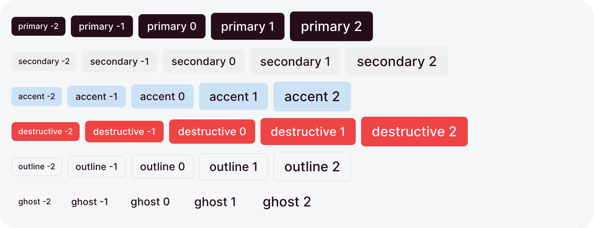
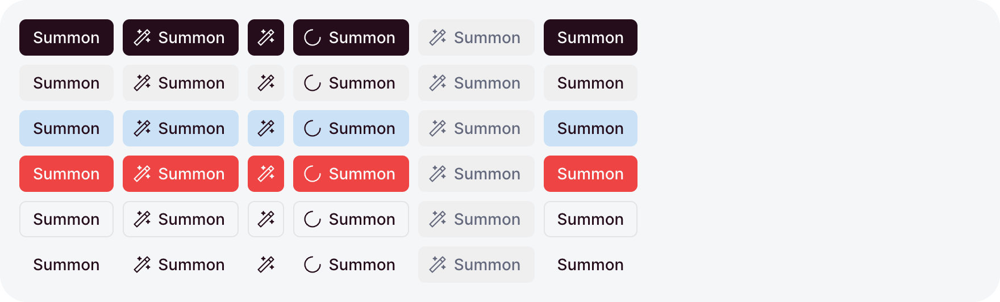
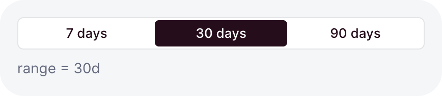
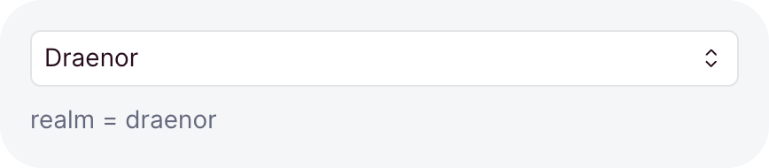
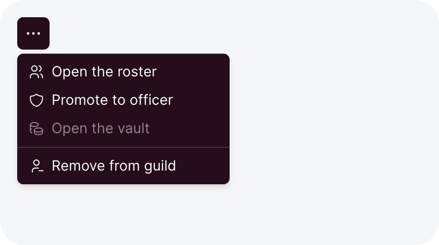
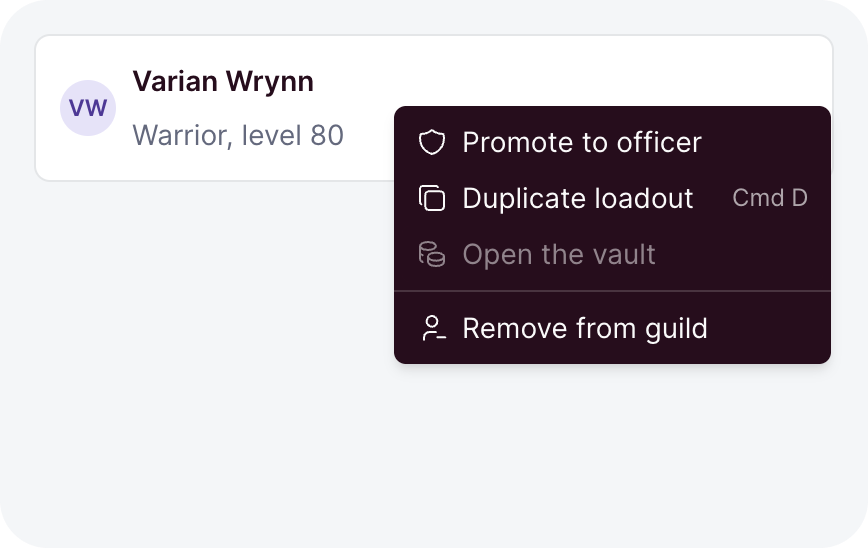
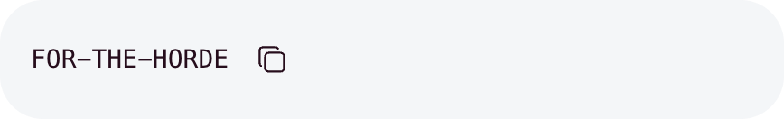

# Actions

Buttons and the controls that act on a page: a group of choices, a select, a menu, a context menu,
a copy button.
Each one is typed by what it holds, so a choice outside the set fails the typecheck.

```ts
// dashboard/pages/raid.ts
import { button, defineDashboardPage, page, toast } from 'ohnejs/dashboard';

export default defineDashboardPage(() =>
  page(
    { title: 'Raid', actions: button('Start raid', { onClick: () => toast('The raid begins') }) },
  ),
);
```

The button sits at the end of the page header and shows a [toast](./feedback.md#toast) when you
click it.

## Variants and sizes

<picture>
  <source media="(prefers-color-scheme: dark)" srcset="../images/kit/button-variant-x-size-dark.png">
  
</picture>

`variant` sets how loud a button is, and `size` how big:

```ts
button('Save', { variant: 'primary' })
button('Cancel', { variant: 'outline', size: -1 })
```

- `primary`, the default, is the one action a region leads with.
- `secondary` and `accent` are quieter fills, `outline` and `ghost` quieter still.
- `destructive` is for an action that deletes or cannot be undone. `destructiveHover: true` keeps
  another variant and turns destructive only on hover.
- `size` runs from `-2` to `2`. Omitted, the button takes the size of its surroundings.

## Icons

`icon` leads the label with a [Tabler icon](https://tabler.io/icons):

```ts
button('Export', { icon: 'download', variant: 'outline' })
```

The label takes a [message key or plain text](./components.md), so
`button('dashboard.cancel')` reads "Cancel" in the dashboard language.

## Icon only

`iconOnly` hides the label and leaves the icon in a square button:

```ts
button('Delete', { icon: 'trash', iconOnly: true, variant: 'ghost' })
button('Export', { icon: 'download', iconOnly: 'md', variant: 'outline' })
```

<picture>
  <source media="(prefers-color-scheme: dark)" srcset="../images/kit/button-variant-x-state-dark.png">
  
</picture>

- The label stays the button's accessible name and shows as a tooltip on hover.
- A [container step](./layout.md#container-steps) hides the label only while the container is
  narrower than that step. `true` always hides it.

## Loading and disabled

`loading` and `disabled` take a getter, so the button follows your state:

```ts
const save = useAction('PATCH /raid-settings', { form: settings });

button('Save', {
  loading: () => save.busy(),
  disabled: () => !settings.dirty(),
  onClick: () => save.run(),
})
```

- While `loading` answers `true`, a spinner replaces the icon and clicks do nothing. The button
  keeps its colors.
- While `disabled` answers `true`, the button dims and leaves the tab order.
- [`useAction`](./data.md#writing-with-useaction)'s `busy` is the usual loading getter.

## Links

`href` renders the button as a link. The router opens a dashboard path in place:

```ts
button('Open the roster', { href: '/roster', icon: 'users' })
button('Wowhead', { href: 'https://www.wowhead.com', target: '_blank', variant: 'outline' })
```

A disabled link stays a link in the markup but stops navigating.

## Button group

<picture>
  <source media="(prefers-color-scheme: dark)" srcset="../images/kit/buttongroup-typed-union-ref-dark.png">
  
</picture>

`buttonGroup` picks one value out of a few, like a range:

```ts
const range = ref<'7d' | '30d' | '90d'>('30d');

buttonGroup(range, {
  choices: () => [
    { value: '7d', label: '7 days' },
    { value: '30d', label: '30 days' },
    { value: '90d', label: '90 days' },
  ],
})
```

- The ref types the choices: a `value` outside `'7d' | '30d' | '90d'` fails the typecheck.
- A choice can be `null`, for a "none" option on a nullable ref.
- `variant: 'accent'` paints the group in the accent colors.
- The arrow keys step through the choices.

## Icon group

`iconGroup` is the same control with square icon cells:

```ts
const device = ref<'desktop' | 'mobile'>('desktop');

iconGroup(device, {
  showTooltips: true,
  choices: () => [
    { value: 'desktop', icon: 'device-desktop', title: 'Desktop' },
    { value: 'mobile', icon: 'device-mobile', title: 'Mobile' },
  ],
})
```

`title` names each choice. With `showTooltips`, it shows as a styled tooltip on hover.

## Select

<picture>
  <source media="(prefers-color-scheme: dark)" srcset="../images/kit/select-typed-union-ref-dark.png">
  
</picture>

`select` picks one value out of many, typed by its ref the same way:

```ts
const realm = ref<'draenor' | 'stormrage' | 'tichondrius'>('draenor');

select(realm, () => [
  { value: 'draenor', label: 'Draenor' },
  { value: 'stormrage', label: 'Stormrage' },
  { group: 'Player versus player', choices: [{ value: 'tichondrius', label: 'Tichondrius' }] },
])
```

- `group` heads a set of choices with a label.
- A choice can be `disabled`, or `muted` to dim it.
- `placeholder` shows while no choice matches the ref.
- While it is open, typing highlights the best matching choice.

Wrap it in [`formField`](./forms.md#wrapping-a-control) to give it a label.

## Menu

`menu` opens a dropdown of actions from a button you pass, and returns that button:

```ts
menu(button('More actions', { icon: 'dots', iconOnly: true, variant: 'ghost' }), [
  [
    { label: 'Open profile', icon: 'user', href: `/members/${member.name}` },
    isLeader && { label: 'Promote to officer', icon: 'shield', onSelect: () => promote(member) },
  ],
  [{ label: 'Remove from guild', icon: 'trash-x', destructive: true, onSelect: remove }],
])
```

<picture>
  <source media="(prefers-color-scheme: dark)" srcset="../images/kit/menu-icons-divider-destructive-disabled-link-dark.png">
  
</picture>

- The rows come in groups, and a divider separates two groups.
- `false` or `undefined` in place of a row skips it, so `allowed && row` hides what the user cannot do.
  A group left without rows draws no divider, and a menu without rows does not open.
- `onSelect` runs after the menu closes. `href` makes the row a link instead.
- `disabled` takes a getter. A disabled row dims and ignores clicks.
- `hotkey` names a dashboard hotkey, like `'duplicate'`, and shows its key at the row's end.
  Pressing that key while the menu is open picks the row.
- Escape and a click outside close the menu, and focus returns to the button.

A [table's row actions](./tables.md#row-actions) take the same groups.

## Context menu

`contextMenu` opens a menu at the pointer when you right-click an element, and returns that element:

```ts
// dashboard/pages/roster.ts
import { contextMenu, defineDashboardPage, h, page, toast } from 'ohnejs/dashboard';

const members = ['Thrall', 'Jaina Proudmoore', 'Anduin Wrynn'];

export default defineDashboardPage(() =>
  page(
    { title: 'Roster' },
    h(
      'ul',
      null,
      members.map((name) =>
        contextMenu(h('li', { tabindex: 0 }, name), [
          [
            { label: 'Open profile', icon: 'user', href: `/members/${name}` },
            { label: 'Promote to officer', icon: 'shield', onSelect: () => toast(`Promoted ${name}`) },
          ],
          [
            {
              label: 'Remove from guild',
              icon: 'trash-x',
              destructive: true,
              onSelect: () => toast(`${name} left the guild`),
            },
          ],
        ]),
      ),
    ),
  ),
);
```

<picture>
  <source media="(prefers-color-scheme: dark)" srcset="../images/kit/contextmenu-any-element-hotkey-hint-disabled-row-dark.png">
  
</picture>

- It takes the groups [`menu`](#menu) takes. Pass a getter to build them on each open, for example
  from a selection.
- The context-menu key and Shift+F10 open it too. Give the element a `tabindex` so the keyboard
  can reach it.
- On a touch screen, a held finger opens it. Pass `touch: false` where a hold starts a drag.
- Links, buttons, fields, and editable text inside the element keep the browser's own menu, and
  so does a Shift right-click. `ignore` takes a CSS selector to change which elements keep it.

A context menu is easy to miss, so offer its actions somewhere visible too, like a
[`menu`](#menu) button.

## Copy button

`copyButton` copies text to the clipboard:

```ts
copyButton(() => guild.value.inviteCode, { label: 'Copy invite code' })
```

<picture>
  <source media="(prefers-color-scheme: dark)" srcset="../images/kit/copybutton-default-label-dark.png">
  
</picture>

- The text can be a string or a getter, read at the moment of the click.
- After a copy, the icon turns into a check and the tooltip says "Copied".
- Omitted, `label` reads "Copy". It is the accessible name and the tooltip.
