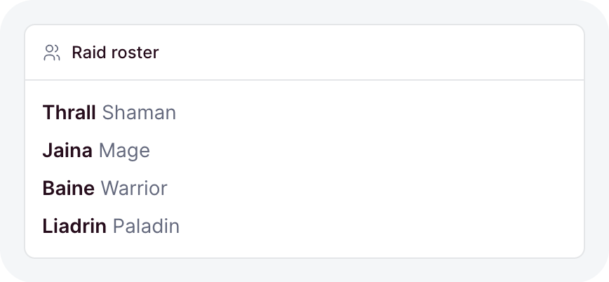
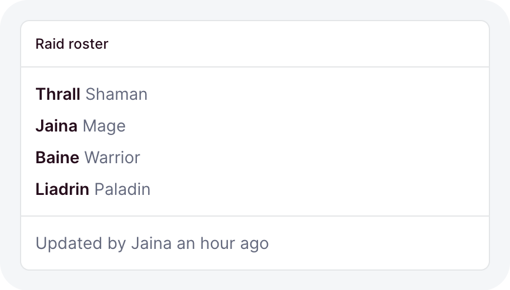
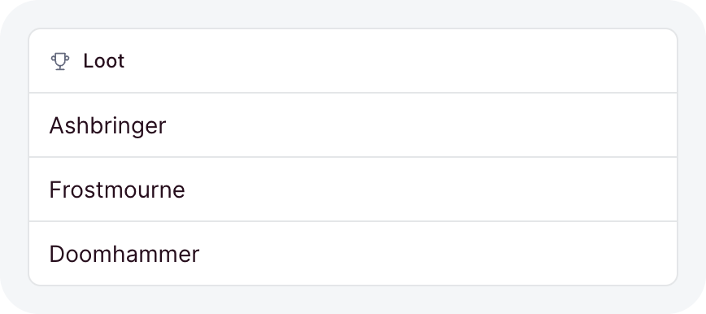
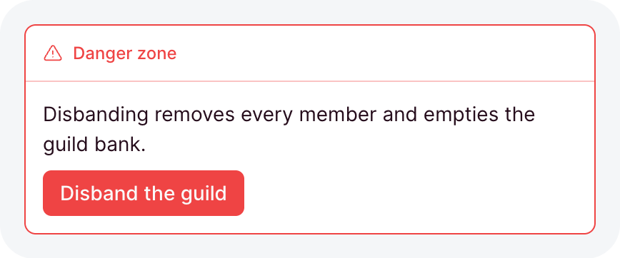
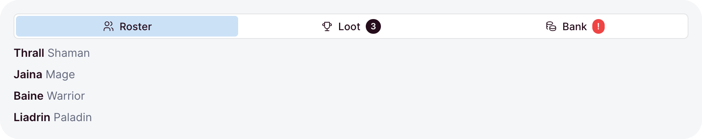
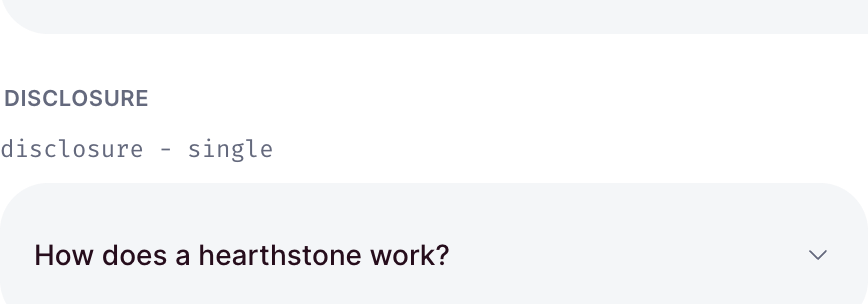

# Cards and tabs

A card is the kit's surface: a bordered box that holds one thing on a page, with an optional header
and footer. Tabs and disclosures fold more content into the same space and show one part at a time.

```ts
// dashboard/pages/roster.ts
import { card, defineDashboardPage, page } from 'ohnejs/dashboard';

export default defineDashboardPage(() =>
  page(
    { title: 'Roster' },
    card('Thrall, Jaina Proudmoore, and Baine', { title: 'Raid roster', icon: 'users' }),
  ),
);
```

<picture>
  <source media="(prefers-color-scheme: dark)" srcset="../images/kit/card-title-and-icon-dark.png">
  
</picture>

The body comes first, the options second. A body is anything a page renders: text, an element, a
[table](./tables.md), a [chart](./charts.md).

## The header

`title`, `icon`, `badge`, and `actions` build the header:

```ts
card(roster, {
  title: 'Raid roster',
  icon: 'users',
  badge: badge('4 / 25', { size: -2 }),
  actions: button('Invite', { icon: 'user-plus', variant: 'outline', size: -1 }),
})
```

<picture>
  <source media="(prefers-color-scheme: dark)" srcset="../images/kit/card-title-icon-badge-actions-dark.png">
  
</picture>

- `title` takes a [message key or plain text](./components.md).
- `icon` names a [Tabler icon](https://tabler.io/icons), muted before the title.
- `header` replaces the built header with your own content.
- A card with none of them has no header at all.

## View all

`more` adds a muted link at the end of the header, to the page that shows everything the card
summarizes:

```ts
card(recentRaids, { title: 'Recent raids', more: { href: '/raids' } })
```

Omitted, its `label` reads "View all". Name the destination when it says more:
`more: { href: '/bank', label: 'Open the bank' }`.

## A card that links

`href` turns the whole card into one link, with a hover and a focus ring:

```ts
card(summary, { title: 'Icecrown Citadel', href: '/raids/icecrown' })
```

- The whole surface is the link, never just the title.
- A linking card holds no other link or button, so its type refuses `actions`, `more`,
  `collapsible`, and `header` beside `href`.
- A [stat tile](./charts.md#stat) links the same way.

## Footer

`footer` renders under the body, behind a separating border:

```ts
card(settings.element, { title: 'Raid settings', footer: button('Save') })
```

<picture>
  <source media="(prefers-color-scheme: dark)" srcset="../images/kit/card-footer-dark.png">
  
</picture>

It usually holds a [form](./forms.md)'s save button, or a muted line saying when the data last
changed.

## Flush

`flush: true` drops the body padding, so a [table](./tables.md) or a [list](./display.md#list)
runs edge to edge:

```ts
card(lootList, { title: 'Loot', icon: 'trophy', flush: true })
```

<picture>
  <source media="(prefers-color-scheme: dark)" srcset="../images/kit/card-flush-body-dark.png">
  
</picture>

## Danger zone

`tone: 'destructive'` paints the border and the title in the destructive color, for actions that
cannot be undone:

```ts
card(disband, { title: 'Danger zone', icon: 'alert-triangle', tone: 'destructive' })
```

<picture>
  <source media="(prefers-color-scheme: dark)" srcset="../images/kit/card-destructive-tone-dark.png">
  
</picture>

## Collapsible

`collapsible` adds a toggle to the header that folds the body and the footer away:

```ts
const open = ref(true);

card(roster, { title: 'Raid roster', collapsible: { open } })
```

- `collapsible: true` starts open and keeps its own state.
- `{ open }` binds a ref, so your code can fold the card and read whether it is open.

## Size and failures

- `size` from `-2` to `2` scales the card and everything inside it. Omitted, the card takes the
  size of its surroundings.
- A function body that throws while it builds shows an error state inside the card, and the rest
  of the page keeps working.

## Tabs

`tabs` shows one panel at a time under a row of tabs:

```ts
tabs([
  { name: 'roster', label: 'Roster', icon: 'users', content: () => roster() },
  { name: 'loot', label: 'Loot', icon: 'trophy', bubble: bubble('3'), content: () => loot() },
])
```

<picture>
  <source media="(prefers-color-scheme: dark)" srcset="../images/kit/tabs-icons-and-bubbles-dark.png">
  
</picture>

- `content` builds the panel each time its tab opens, and switching away disposes it. Keep state
  that must survive in a ref outside the panel.
- `bubble` puts a count after the label.
- The tab row shows only with more than one tab.

## Controlling the tabs

`active` binds the open tab to a ref. With [`useSearchParam`](./pages.md#state-in-the-url), the
open tab survives a reload and a shared link:

```ts
const view = useSearchParam('view', { fallback: 'roster', choices: ['roster', 'loot'] });

tabs(
  [
    { name: 'roster', label: 'Roster', content: () => roster() },
    { name: 'loot', label: 'Loot', content: () => loot() },
  ],
  { active: view },
)
```

- The ref types the names, so a tab named outside its values fails the typecheck.
- A value no tab carries shows the first tab.
- Omitted, the tabs keep their own state and start on the first.

## Disclosure

`disclosure` hides content behind a row that opens it:

```ts
disclosure(() => h('p', null, 'Need before greed, always.'), {
  summary: 'What are the loot rules?',
  group: 'raid-faq',
})
```

<picture>
  <source media="(prefers-color-scheme: dark)" srcset="../images/kit/disclosure-grouped-accordion-dark.png">
  
</picture>

- The content builds on the first open and stays mounted, so its state survives closing.
- `open` binds a ref. Omitted, the disclosure starts closed.
- Disclosures sharing a `group` form an accordion: opening one closes the others.

Reach for tabs when the parts are peers a reader switches between, and a disclosure for detail most
readers skip.
