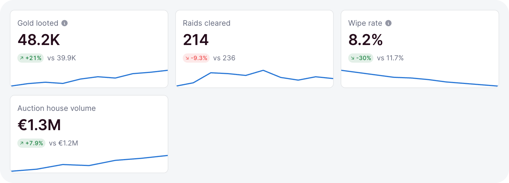
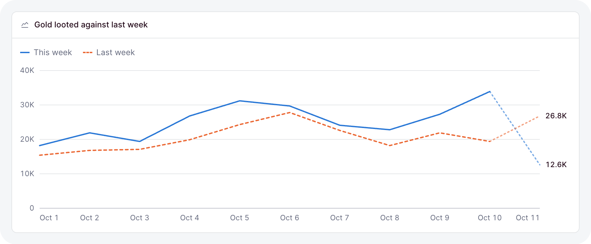
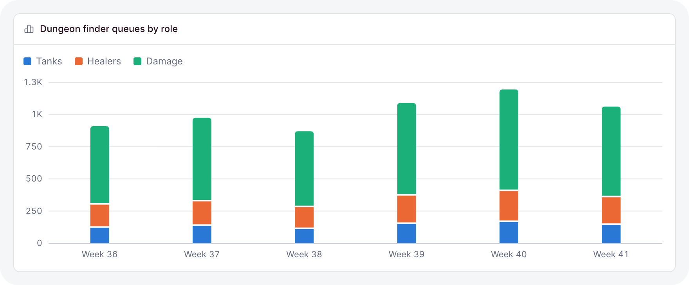
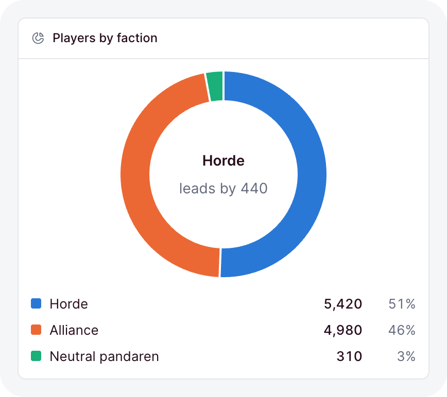
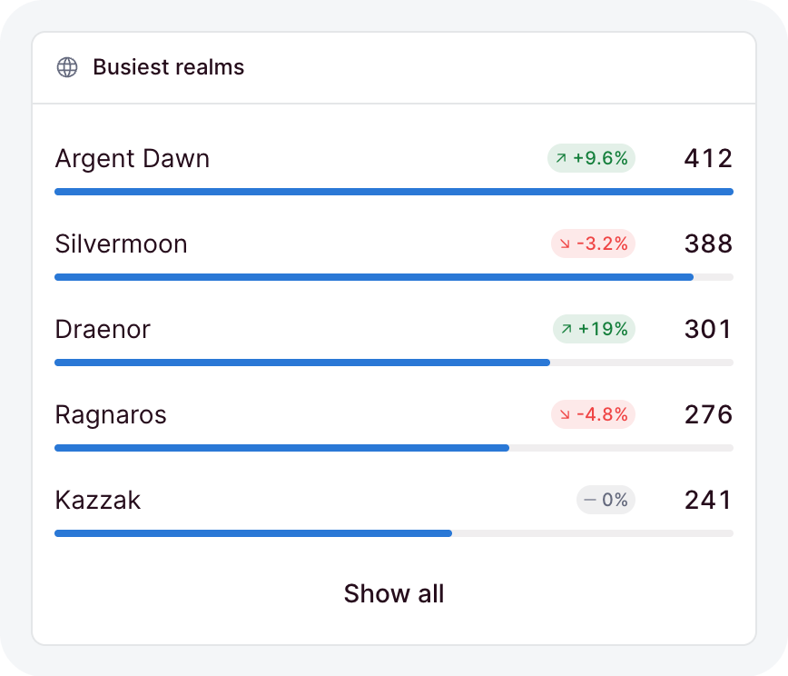

# Stats and charts

The dashboard ships the numbers and charts a page usually needs: stat tiles, line, area and bar
charts, donuts, ranked bar lists, and funnels. Each one takes a getter for its data, draws its own
loading and empty states, and stays readable with a keyboard and a screen reader.

```ts
// dashboard/pages/raids.ts
import { card, defineDashboardPage, grid, lineChart, page, stat } from 'ohnejs/dashboard';
import { ref } from 'ohnejs/utils';

interface Day {
  day: string;
  gold: number;
}

export default defineDashboardPage(() => {
  const days = ref<Day[]>([
    { day: 'Mon', gold: 1840 },
    { day: 'Tue', gold: 2210 },
    { day: 'Wed', gold: 1975 },
  ]);

  return page(
    { title: 'Raids' },
    grid(
      { min: '13rem', minColumns: 2 },
      stat(() => ({ value: 48_210, previous: 39_870 }), { label: 'Gold looted' }),
      stat(() => 214, { label: 'Raids cleared' }),
    ),
    card(
      lineChart(() => days.value, {
        x: (row) => row.day,
        series: [{ name: 'Gold looted', value: (row) => row.gold }],
      }),
      { title: 'Gold per day' },
    ),
  );
});
```

The chart redraws whenever `days` changes. Every `row` is typed from the data, so a typo in a field
fails the typecheck.

## Which one to reach for

Start from the question the reader asks:

| Question                               | Reach for                 |
| -------------------------------------- | ------------------------- |
| What is the number, and is it better?  | `stat`                    |
| How did it move over time?             | `lineChart`, `area: true` |
| How do a few categories compare?       | `barChart`                |
| What makes up the whole?               | `donutChart` or `stacked` |
| Which items lead a long ranking?       | `barList`                 |
| Where do people drop out of a process? | `funnel`                  |

A single number is a `stat`, never a one-bar chart. To compare close values, prefer bars to a donut.

## Data in, states out

Every chart and stat takes its data as a getter:

```ts
barChart(() => realms.value, { x: (realm) => realm.name, series })
```

- `undefined` shows a placeholder at the chart's height, so nothing jumps when data lands.
- `[]` shows an empty state.
- A [`useResource`](./data.md) result works as the getter directly. A failed read shows an error
  with a retry, a `403` shows a locked state, and a refetch dims the old chart instead of blanking
  it.

## Stat

<picture>
  <source media="(prefers-color-scheme: dark)" srcset="../images/kit/stat-ready-with-previous-and-trend-dark.png">
  
</picture>

`stat` shows a figure with its label. Give it a `previous` and a `trend` to add a change pill and a
sparkline:

```ts
stat(() => ({ value: 0.082, previous: 0.117, trend: [0.15, 0.12, 0.1, 0.082] }), {
  label: 'Wipe rate',
  format: (value) => formatNumber(value, { percent: true, decimals: 1 }),
  invert: true,
  help: 'Wipes per boss pull.',
})
```

- Omitted, `format` writes the number in the dashboard language, compact from ten thousand.
- `invert` marks a figure where lower is better, so a drop reads as good news.
- `href` turns the whole tile into a link.
- `delta(() => change)` is the pill on its own, for a change you show elsewhere. Build the change
  with `changeOf(current, previous)` from `ohnejs/utils`.

`formatNumber(value, { compact, currency, percent, decimals, signed })` formats in the dashboard
language and follows it when the language switches. With a `currency`, the value is in major units.

## Line and area

<picture>
  <source media="(prefers-color-scheme: dark)" srcset="../images/kit/linechart-two-series-the-previous-week-dashed-today-partial-dark.png">
  
</picture>

`lineChart` draws one line per series over the rows:

```ts
lineChart(() => days.value, {
  x: (day) => day.date,
  area: true,
  partial: (day) => day.date === today,
  series: [
    { name: 'This week', value: (day) => day.gold },
    { name: 'Last week', value: (day) => day.previous, dashed: true },
  ],
})
```

- A `null` value is a gap: the line breaks instead of dropping to zero.
- `dashed` suits a previous period or a target.
- `partial` marks a row still filling, like today, so the line into it draws lighter.
- `area` washes the area under each solid line. It reads best with a single series.

## Bar

<picture>
  <source media="(prefers-color-scheme: dark)" srcset="../images/kit/barchart-stacked-dark.png">
  
</picture>

`barChart` takes the same `x` and `series`:

```ts
barChart(() => weeks.value, {
  x: (week) => week.label,
  stacked: true,
  series: [
    { name: 'Tanks', value: (week) => week.tanks },
    { name: 'Healers', value: (week) => week.healers },
  ],
})
```

- Several series sit side by side; `stacked` stacks them into one bar.
- `horizontal` names each row at its start. Use it for many or long-named categories. A single
  series then writes each value at its bar's tip.

## Donut

<picture>
  <source media="(prefers-color-scheme: dark)" srcset="../images/kit/donutchart-with-a-custom-center-dark.png">
  
</picture>

`donutChart` shows each row's share of the whole, with the total in the hole:

```ts
donutChart(() => factions.value, {
  label: (faction) => faction.name,
  value: (faction) => faction.players,
})
```

Pass `center` to put your own figure in the hole. A legend beside the ring lists every value and
share.

## Bar list and funnel

<picture>
  <source media="(prefers-color-scheme: dark)" srcset="../images/kit/barlist-previous-period-links-show-all-dark.png">
  
</picture>

`barList` ranks rows with a thin bar under each label. Pass the rows biggest first:

```ts
barList(() => realms.value, {
  label: (realm) => realm.name,
  value: (realm) => realm.raids,
  previous: (realm) => realm.lastWeek,
  href: (realm) => `/realms/${realm.slug}`,
  visible: 5,
})
```

- `previous` adds a change pill per row.
- `href` makes each row a link.
- `visible` shows the top rows and a button for the rest.

`funnel` takes the steps in order, with the same `label` and `value`. Under each step it writes the
share of the step before and of the first.

`sparkline(() => values)` is the small trend line a stat uses, for anywhere else you need one.

## Colors

Colors come from the eight `--ohne-chart-1` to `--ohne-chart-8` tokens, in a fixed order checked for
color-vision deficiency in light and dark:

- A single series draws in `--ohne-chart-1`, with no legend; the [card](./cards-and-tabs.md) title names it.
- Two or more series take the slots in the order you list them, with a legend. A series keeps its
  color when you add or remove another after it.
- Past eight series or slices, the rest fold into one "Other" in a muted gray. A donut keeps the
  seven largest slices.

Charts never use the status colors, so green and red keep meaning good and bad. Override the tokens
in your theme to rebrand every chart at once.

## Accessibility you get for free

- Each chart is one Tab stop. The arrow keys step through rows or slices, and Home, End and Escape
  work too.
- A tooltip reads every series at the active row, on hover, tap and keyboard alike.
- A hidden table carries every number to a screen reader.
- Labels and values stay in the text colors; a colored key beside them carries the series.
- A change pill pairs its color with an arrow and a sign, so color is never the only signal.
- Animations respect reduced motion.
