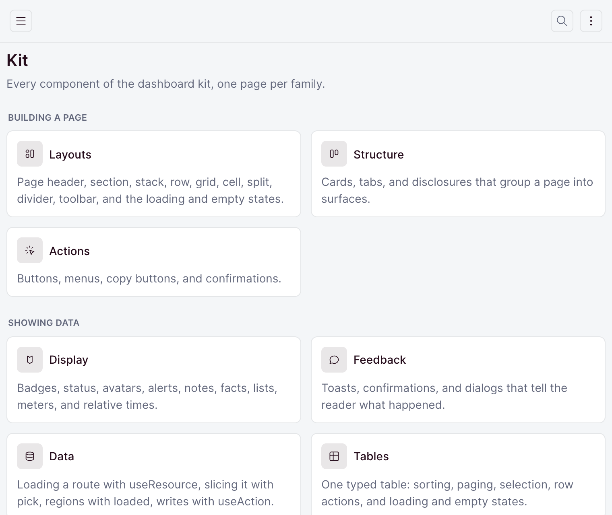
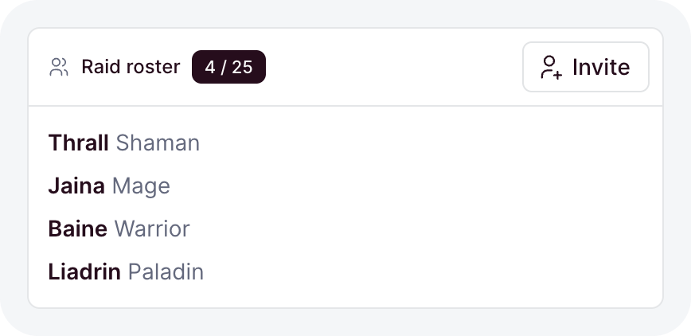
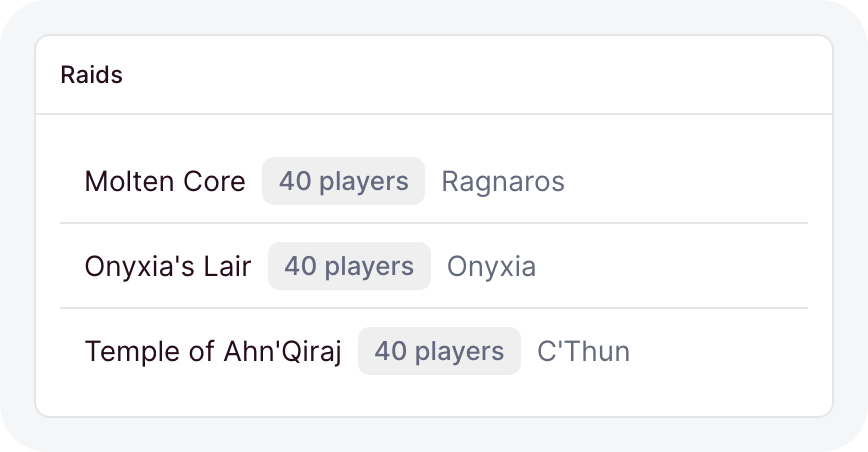
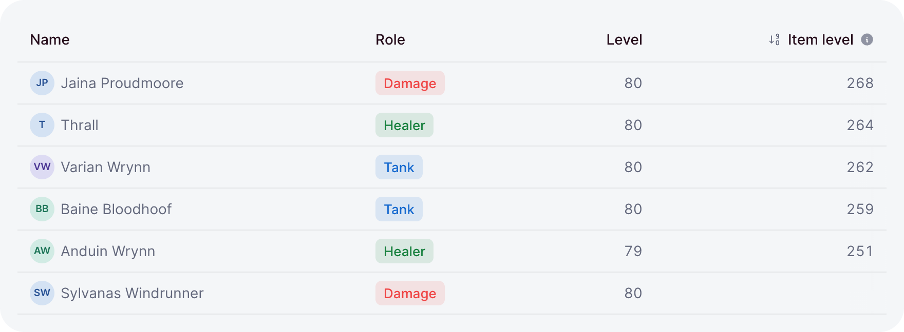
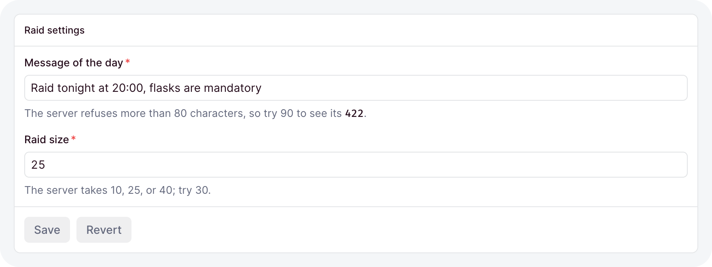

# Components

The kit is every component `ohnejs/dashboard` ships for building a page, and they all speak one
grammar. A label takes a [message key](../i18n/messages.md#catalogs) or plain text: a known key
translates, any other string shows as written, and a getter stays live. A data component takes a
getter, where `undefined` means loading and `[]` means empty, and a
[`useResource`](./data.md#loading-a-route) result adds the failed and forbidden states. A color is
a [tone](./display.md#tones) named by its meaning, never a hex value. Spacing is a
[gap step](./layout.md#gap-steps) from `-2` to `2`, never a length.

Try every component live in the [kit](https://kit.ohne.dev).

<picture data-live="/">
  <source media="(prefers-color-scheme: dark)" srcset="../images/kit/catalog-dark.png">
  
</picture>

## Layout

<picture>
  <source media="(prefers-color-scheme: dark)" srcset="../images/kit/page-every-option-dark.png">
  
</picture>

`page`, `section`, `stack`, `row`, `grid`, `cell`, `split`, `divider`, and `toolbar`.
[Layout](./layout.md) places the blocks of a page.

## Cards and tabs

<picture>
  <source media="(prefers-color-scheme: dark)" srcset="../images/kit/card-title-icon-badge-actions-dark.png">
  
</picture>

`card`, `tabs`, and `disclosure`. [Cards and tabs](./cards-and-tabs.md) group a page into
surfaces.

## Actions

<picture>
  <source media="(prefers-color-scheme: dark)" srcset="../images/kit/button-variant-x-size-dark.png">
  
</picture>

`button`, `buttonGroup`, `iconGroup`, `select`, `menu`, and `copyButton`. [Actions](./actions.md)
covers the controls that act on a page.

## Display

<picture>
  <source media="(prefers-color-scheme: dark)" srcset="../images/kit/badge-variant-soft-every-tone-dark.png">
  
</picture>

`badge`, `statusBadge`, `statusDot`, `icon`, `avatar`, `alert`, `note`, `facts`, `list`, `meter`,
`relativeTime`, and the empty, error, and loading states. [Display](./display.md) shows values and
states.

## Feedback

`toast`, `confirm`, and `openDialog`. [Feedback](./feedback.md) tells the reader what happened.

## Data

<picture>
  <source media="(prefers-color-scheme: dark)" srcset="../images/kit/ready-dark.png">
  
</picture>

`useResource`, `loaded`, and `useAction`. [Data in the dashboard](./data.md) loads and saves
through your API.

## Tables

<picture>
  <source media="(prefers-color-scheme: dark)" srcset="../images/kit/table-value-and-render-columns-sorted-by-a-ref-a-help-tooltip-dark.png">
  
</picture>

`table` and `pagination`. [Tables](./tables.md) shows typed rows with sorting, paging, and
selection.

## Stats and charts

<picture>
  <source media="(prefers-color-scheme: dark)" srcset="../images/kit/linechart-two-series-the-previous-week-dashed-today-partial-dark.png">
  
</picture>

`stat`, `delta`, `lineChart`, `barChart`, `donutChart`, `barList`, `funnel`, and `sparkline`.
[Stats and charts](./charts.md) draws the numbers.

## Forms

<picture>
  <source media="(prefers-color-scheme: dark)" srcset="../images/kit/form-useaction-skeleton-rows-until-the-settings-load-a-422-lands-on-its-field-dark.png">
  
</picture>

`form`, `field`, `fieldInput`, and `formField`. [Forms](./forms.md) asks for input and saves it.

To see them working together, build [your first page](./first-page.md).
