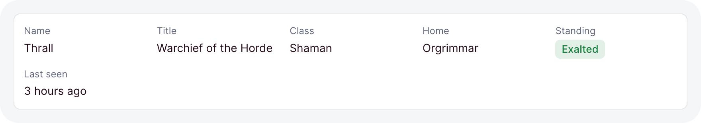
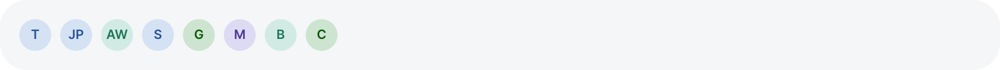
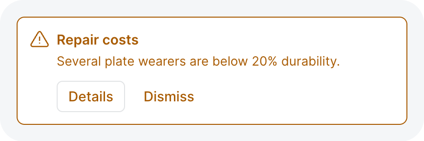
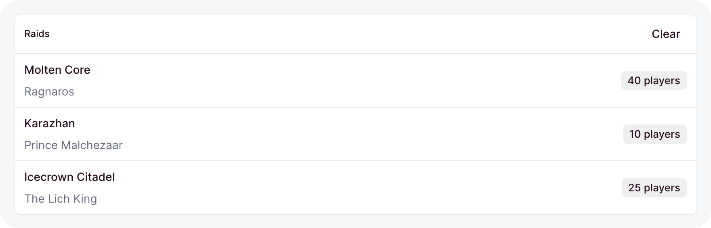
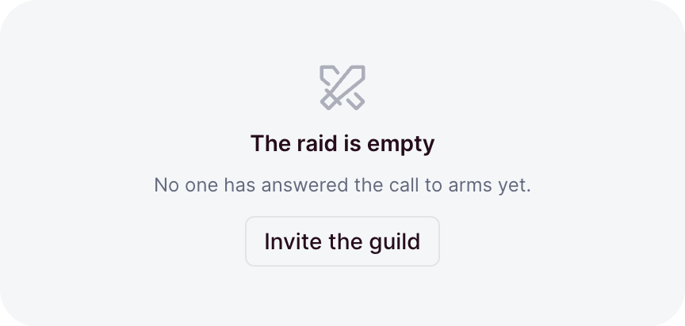

# Display

The pieces that show a value or a state: badges, status lights, icons, avatars, alerts, notes,
labeled facts, lists, meters, and times. None of them takes input. They show what your data says,
and follow it when it changes.

```ts
// dashboard/pages/thrall.ts
import { badge, card, defineDashboardPage, facts, page, relativeTime } from 'ohnejs/dashboard';

export default defineDashboardPage(() =>
  page(
    { title: 'Thrall', badge: badge('Warchief', { tone: 'accent' }) },
    card(
      facts([
        { label: 'Faction', value: 'Horde' },
        { label: 'Home', value: 'Orgrimmar' },
        { label: 'Last seen', value: relativeTime(Date.now() - 3 * 60 * 60 * 1000) },
      ]),
    ),
  ),
);
```

<picture>
  <source media="(prefers-color-scheme: dark)" srcset="../images/kit/facts-columns-auto-dark.png">
  
</picture>

## Tones

A component's color is a tone, named by what it means:

- `primary`, `secondary`, `accent` - the theme's own colors.
- `success`, `warning`, `info`, `destructive` - the status tones.
- `neutral` - a muted gray, for something that is not active.

Each tone has its light and dark shade, so you never pick a color by hand. A status tone always
comes with a label or an icon, so color is never the only signal.

## Badge

<picture>
  <source media="(prefers-color-scheme: dark)" srcset="../images/kit/badge-variant-soft-every-tone-dark.png">
  
</picture>

`badge` is a small pill label:

```ts
badge('Draft', { tone: 'neutral' })
badge('Online', { tone: 'success', variant: 'soft', dot: true })
badge('Verified', { tone: 'info', variant: 'outline', icon: 'circle-check' })
```

- `variant` is `solid`, the default, `soft` for a tint, or `outline` for a ring.
- `dot` leads with a small dot, `icon` with an icon.
- A long label truncates with an ellipsis.

## Status

`statusBadge` shows one state out of a fixed set. You describe each state once, and the badge
follows the live one:

```ts
const DEPLOY = {
  queued: { tone: 'neutral', label: 'Queued' },
  live: { tone: 'success', label: 'Live', icon: 'circle-check' },
  failed: { tone: 'destructive', label: 'Failed', icon: 'alert-triangle' },
} as const;

statusBadge(() => deploy.value.state, DEPLOY)
```

<picture>
  <source media="(prefers-color-scheme: dark)" srcset="../images/kit/statusbadge-deploy-states-dark.png">
  
</picture>

A state without an `icon` leads with a dot. `statusDot` is the smaller light for something that
runs, waits, or stops, with an optional label beside it:

```ts
statusDot(() => (worker.value.busy ? 'on' : 'idle'), { label: 'Auction house worker' })
```

`on` pulses in the success tone, `idle` waits in the warning tone, and `off` sits muted.

## Icon

`icon` draws a [Tabler icon](https://tabler.io/icons) by name, sized to the text around it:

```ts
h('p', null, icon('clock'), ' Raid starts at 20:00')
icon('circle-check', { tone: 'success', size: 2 })
```

- Omitted, `tone` keeps the text color.
- `size` pins the icon to a step instead of the text size.

## Avatar

`avatar` shows a person's picture, or their initials when there is none:

```ts
avatar('Jaina Proudmoore')
avatar(() => user.value.name, { src: () => user.value.photo, size: 2 })
```

<picture>
  <source media="(prefers-color-scheme: dark)" srcset="../images/kit/avatar-initials-colored-by-name-dark.png">
  
</picture>

The initials sit on a color picked by the name, so one person always wears the same color.

## Alert and note

<picture>
  <source media="(prefers-color-scheme: dark)" srcset="../images/kit/alert-tone-warning-dark.png">
  
</picture>

`alert` is a callout the reader must notice:

```ts
alert('Several plate wearers are below 20% durability.', {
  tone: 'warning',
  title: 'Repair costs',
  icon: 'alert-triangle',
  actions: button('Details', { variant: 'outline', size: -1 }),
})
```

- `primary`, the default tone, is a plain box. A status tone rings and tints it in its color.
- A `destructive` or `warning` alert is announced to screen readers at once.

`note` is the quiet version, a hint that should not compete with the content:

```ts
note('Changes to the roster go live after the next raid reset.')
```

Give it a `tone` when the hint warns:

```ts
note('Once you save, this is no longer the home page.', { tone: 'warning', icon: 'alert-triangle' })
```

## Facts

`facts` shows labeled values in a grid, like a record's summary:

```ts
facts(() => hero.value?.facts, { columns: 2 })
```

- A value can be any content: text, a badge, a relative time.
- `columns` is `auto`, the default, which fits as many as the width allows, `2`, or `1`.
- While the rows are `undefined`, placeholders hold their height.

## List

`list` renders items as divided rows. Alone in a card, the rows run to the card's edges:

```ts
card(
  list(
    () => raids.value,
    (raid) => h('span', null, () => raid().name),
    { key: (raid) => raid.id, empty: 'No raids scheduled' },
  ),
  { title: 'Raids' },
)
```

<picture>
  <source media="(prefers-color-scheme: dark)" srcset="../images/kit/list-items-in-a-flush-card-dark.png">
  
</picture>

- `key` names each item, so a row keeps its state when the items change.
- `render` runs once per item and gets a getter, the way [`each`](./rendering.md#lists) does.
- `undefined` shows placeholder rows, and `[]` the `empty` text.

## Meter

`meter` shows how full something is:

```ts
meter(() => bank.value?.usedSlots, { max: 500, label: 'Guild bank slots', tone: 'warning' })
```

- Omitted, `max` is `100`.
- `label` shows above the bar with the share in percent.
- `undefined` shows a placeholder bar.

## Relative time

`relativeTime` writes a moment as words, like "3 hours ago":

```ts
relativeTime(() => record.value.updatedAt)
```

It takes a timestamp or a `Date`, keeps ticking, and shows the exact date and time in a tooltip.

## Empty and error states

<picture>
  <source media="(prefers-color-scheme: dark)" srcset="../images/kit/emptystate-icon-title-action-dark.png">
  
</picture>

Data components draw these for you. Reach for them in a region you build yourself:

```ts
emptyState('No one has answered the call yet.', {
  icon: 'swords',
  title: 'The raid is empty',
  action: button('Invite the guild', { variant: 'outline', size: -1 }),
})

errorState('The portal collapsed.', { retry: () => raids.reload() })
```

- Omitted, the empty state's `icon` is an inbox.
- Omitted, the error text reads "Failed to load". `retry` adds a retry button.
- [`loaded`](./data.md#while-it-loads) picks between them for you.

## Skeleton and spinner

`skeleton` holds a loading region at its final height. `spinner` is a small rotating loader:

```ts
skeleton({ lines: 3 })
skeleton({ height: '12rem' })
spinner({ size: -1 })
```

- `lines` stands in for text, `height` for a solid block like a chart.
- Prefer a skeleton for content, so nothing jumps when it lands. A spinner suits a short wait
  with no shape to hold.
