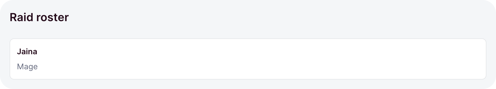
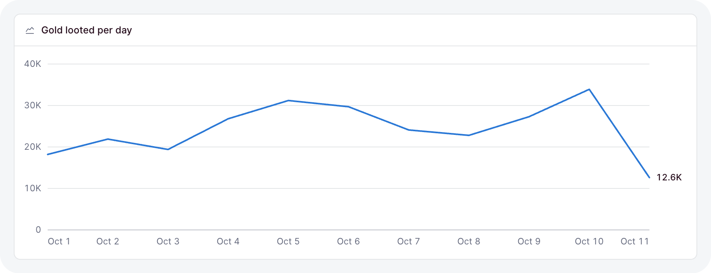

# Your first page

This guide builds one realistic page, a guild overview, one step at a time: a heading, the numbers,
a chart, a table, and a settings form. Each step adds a few lines to the same file, and the page
works after every step.

The page reads three routes from your API: `GET /guild/overview`, `GET /guild/members`, and
`GET /guild/settings` with its `PATCH`. [Routes](../api/routes.md) shows how to write them.

## A page with a title

Create the file. `page` draws the heading and names the browser tab:

```ts
// dashboard/pages/guild.ts
import { defineDashboardPage, page } from 'ohnejs/dashboard';

export default defineDashboardPage(() => {
  return page({ title: 'Guild', description: 'Gold, raids, and the people behind them.' });
});
```

<picture>
  <source media="(prefers-color-scheme: dark)" srcset="../images/kit/page-title-only-dark.png">
  
</picture>

Open `http://localhost:9000/guild`. The page sits inside the [frame](./pages.md#the-frame), with
the sidebar beside it. The function has a block body, so the next steps can add lines before the
`return`.

## Stats from the API

Describe what the overview route answers, and read it with `useResource`. Each `pick` takes one
slice of the answer, so a single request feeds every tile:

```ts
interface Overview {
  gold: number;
  goldLastWeek: number;
  raids: number;
  members: number;
  days: { day: string; gold: number }[];
}
```

```ts
const overview = useResource<Overview>('GET /guild/overview');
const gold = overview.pick((value) => ({ value: value.gold, previous: value.goldLastWeek }));

return page(
  { title: 'Guild', description: 'Gold, raids, and the people behind them.' },
  grid(
    { min: '13rem', minColumns: 2 },
    stat(gold, { label: 'Gold' }),
    stat(overview.pick((value) => value.raids), { label: 'Raids cleared' }),
    stat(overview.pick((value) => value.members), { label: 'Members' }),
  ),
);
```

<picture>
  <source media="(prefers-color-scheme: dark)" srcset="../images/kit/stat-ready-with-previous-and-trend-dark.png">
  
</picture>

Add `grid`, `stat`, and `useResource` to the import. The interface goes above `export default`.

- Each tile shows a placeholder until the answer lands, so nothing jumps.
- `previous` adds the change against last week. A failed read shows an error in the tile.
- `minColumns: 2` keeps the tiles in pairs on a phone. [Layout](./layout.md#grid) covers grids.

## A chart in a card

The overview already holds a row per day. Hand that slice to `lineChart`, inside a `card` that
names it:

```ts
card(
  lineChart(overview.pick((value) => value.days), {
    x: (day) => day.day,
    series: [{ name: 'Gold', value: (day) => day.gold }],
  }),
  { title: 'Gold per day' },
),
```

<picture>
  <source media="(prefers-color-scheme: dark)" srcset="../images/kit/linechart-one-series-dark.png">
  
</picture>

Add it after the `grid`, and add `card` and `lineChart` to the import.

- `day` is typed from the slice, so a typo in a field fails the typecheck.
- One series draws without a legend. The card's title names it.
- [Stats and charts](./charts.md) has the other charts and when to reach for each.

## A table of members

The members come from their own route. Read them with a second resource, above the `return`:

```ts
interface Member {
  name: string;
  role: string;
  level: number;
}
```

```ts
const members = useResource<Member[]>('GET /guild/members');
```

Then add a card with the table after the chart:

```ts
card(
  table(members, {
    key: (member) => member.name,
    columns: {
      name: { label: 'Name', value: (member) => member.name, sortable: 'text' },
      role: { label: 'Role', render: (member) => badge(member.role, { variant: 'soft' }) },
      level: { label: 'Level', value: (member) => member.level, align: 'end' },
    },
  }),
  { title: 'Members', flush: true },
),
```

<picture>
  <source media="(prefers-color-scheme: dark)" srcset="../images/kit/table-value-and-render-columns-sorted-by-a-ref-a-help-tooltip-dark.png">
  
</picture>

Add `badge` and `table` to the import.

- `flush` runs the table to the card's edges.
- Skeleton rows show while the members load, and an empty guild shows an empty state.
- [Tables](./tables.md) adds paging, selection, and row actions.

## A settings form

Last, a form for the guild's settings. Declare its fields above `export default`:

```ts
const fields = {
  motd: field('text', { label: 'Message of the day', max: 80 }),
  size: field('select', { choices: ['10', '25', '40'], display: 'buttons', default: '25' }),
};
```

Above the `return`, load the current settings into a form and bind it to the save route:

```ts
const current = useResource<FormValue<typeof fields>>('GET /guild/settings');
const settings = form({ fields, data: current });
const save = useAction('PATCH /guild/settings', {
  form: settings,
  reload: [current],
  onDone: () => toast('Saved', { type: 'success' }),
});
```

Then add the form's card after the table:

```ts
card(settings.element, {
  title: 'Settings',
  footer: button('Save', {
    disabled: () => !settings.dirty(),
    loading: () => save.busy(),
    onClick: () => save.run(),
  }),
}),
```

<picture>
  <source media="(prefers-color-scheme: dark)" srcset="../images/kit/form-useaction-skeleton-rows-until-the-settings-load-a-422-lands-on-its-field-dark.png">
  
</picture>

Add `button`, `field`, `form`, `type FormValue`, `toast`, and `useAction` to the import.

- The save button wakes up once a field changes, and spins while the request runs.
- A `PATCH` sends only the changed fields. A `422` puts each message under its field.
- [Forms](./forms.md) covers layouts, conditions, and custom field types.

The page now reads three routes, writes one, and shows every loading, empty, and failed state without
a line of state handling. [Components](./components.md) lists the rest of the kit.
