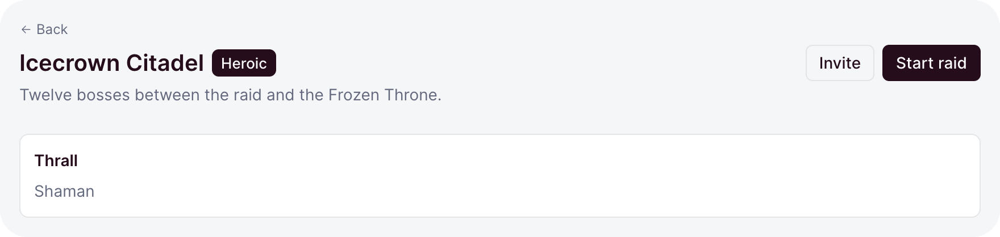
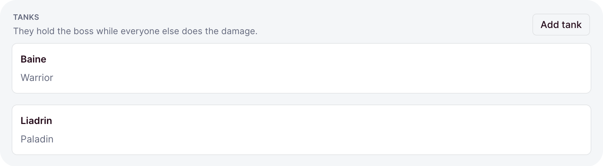
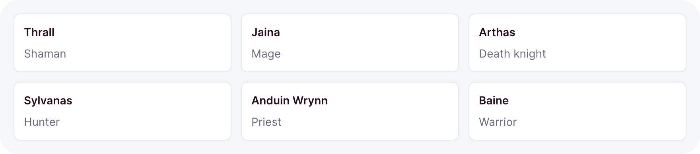
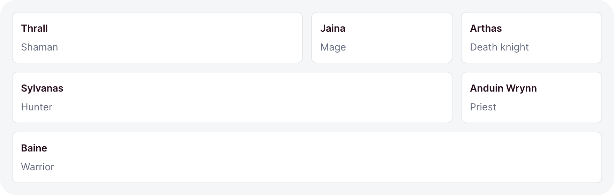
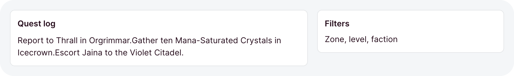

# Layout

A dashboard page is a column of blocks: a header, then sections, then the cards inside them. The
layout components place those blocks with the kit's spacing and breakpoints, so a page needs no CSS
of its own.

```ts
// dashboard/pages/guild.ts
import { card, defineDashboardPage, grid, page, section } from 'ohnejs/dashboard';

export default defineDashboardPage(() =>
  page(
    { title: 'Guild', description: 'Everyone who answers the call.' },
    section(
      { title: 'Officers' },
      grid(card('Thrall'), card('Jaina Proudmoore'), card('Baine')),
    ),
  ),
);
```

You get a heading that also names the browser tab, a small section heading, and cards in as many
columns as the width allows.

## Page

<picture>
  <source media="(prefers-color-scheme: dark)" srcset="../images/kit/page-every-option-dark.png">
  
</picture>

`page` takes the header options first, then the page's content:

```ts
page(
  {
    title: 'Icecrown Citadel',
    description: 'Twelve bosses between the raid and the Frozen Throne.',
    badge: badge('Heroic'),
    back: '/raids',
    actions: [button('Invite', { variant: 'outline' }), button('Start raid')],
  },
  roster,
)
```

- `title` is the `h1` and the [tab title](./pages.md#the-page-title), so you never set both.
- `description` is a muted line under the title, and `badge` sits beside it.
- `back` adds a small back link above the heading.
- `actions` sit at the end of the header, and move under the heading on a page narrower than `md`.

`page` is what sits inside the [frame](./pages.md#the-frame): the frame draws the sidebar and the
chrome, `page` everything from the heading down. Its children stack with gap step `2`.

## Gap steps

Every layout spaces its children by a step, never a length:

| Step | Space         |
| ---- | ------------- |
| `-2` | half the unit |
| `-1` | two thirds    |
| `0`  | the unit      |
| `1`  | four thirds   |
| `2`  | double        |

The unit is the `--ohne-gap` token, `0.75rem` by default. Steps keep a page's rhythm consistent,
and a theme that changes the token respaces every page at once.

- `section`, `stack`, `row` and `grid` default to `0`.
- `split` defaults to `1`, `toolbar` to `-1`.

## Section

<picture>
  <source media="(prefers-color-scheme: dark)" srcset="../images/kit/section-title-description-actions-gap-1-dark.png">
  
</picture>

`section` groups part of a page under a small uppercase heading:

```ts
section(
  {
    title: 'Tanks',
    description: 'They hold the boss while everyone else does the damage.',
    actions: button('Add tank', { variant: 'outline', size: -1 }),
    gap: 1,
  },
  card(baine),
  card(liadrin),
)
```

- `actions` sit at the end of the heading row, usually small buttons.
- Every option is omittable. `section(card(roster), card(bench))` is a plain column.

## Stack and row

`stack` lays its children out top to bottom, `row` side by side:

```ts
stack({ gap: -1 }, alert('The portal is unstable'), card(details))

row({ justify: 'between' }, h('strong', null, 'Thrall'), badge('Warchief'))
```

- `align` places the children across: a stack stretches them, a row centers them.
- `justify` spreads a row: `start`, `center`, `end`, or `between`, which pushes the first and last
  child to the edges.
- A row wraps when its children do not fit. `wrap: false` keeps them on one line.
- Cards in a row share its width, and wrap once they would turn narrower than `16rem`.

Like `section`, both take their options first, or no options at all.

## Grid

<picture>
  <source media="(prefers-color-scheme: dark)" srcset="../images/kit/grid-min-16rem-default-dark.png">
  
</picture>

`grid` places its children in equal tracks, as many of at least `16rem` as fit:

```ts
grid({ min: '13rem', minColumns: 2, gap: 1 }, ...tiles)
```

- `min` is the narrowest a track may get. A container narrower than `min` gets one full-width
  track.
- `minColumns: 2` keeps two tracks and shrinks them below `min` instead, for small tiles like
  [stats](./charts.md#stat).
- The grid answers to its own width, not the window's, so one grid works in a card and on a page.

## Columns per step

`columns` holds a fixed track count instead, or one count per [container step](#container-steps):

```ts
grid({ columns: { base: 1, sm: 2, md: 3, lg: 4 } }, ...cards)
```

- A step's count holds from that step up. A step you leave out keeps the count below it.
- `base` applies under `sm`, and defaults to `1`.
- `columns: 3` holds three tracks at every width.
- With `columns`, `min` and `minColumns` do not apply.

## Cell

<picture>
  <source media="(prefers-color-scheme: dark)" srcset="../images/kit/cell-span-2-span-3-full-in-columns-4-dark.png">
  
</picture>

`cell` wraps one grid child so it spans several tracks:

```ts
grid(
  { columns: 3 },
  cell({ span: 2 }, card(chart)),
  card(totals),
  cell({ span: 'full' }, card(log)),
)
```

- `span: 'full'` fills the whole row.
- In a grid with `columns`, a span never outgrows the track count.
- In a grid without `columns`, a span fills the whole row under the `md` step, so a wide card
  never squeezes.

## Split

<picture>
  <source media="(prefers-color-scheme: dark)" srcset="../images/kit/split-aside-end-default-stacks-under-md-dark.png">
  
</picture>

`split` sets a main column beside a fixed-width aside:

```ts
split({ side: 'start', aside: '14rem', stackUnder: 'lg' }, questLog, filters)
```

- `aside` is the aside's width. Omitted, it is `20rem`.
- `side` puts the aside at the `end`, the default, or the `start`.
- Under the `stackUnder` step, `md` by default, the two stack with the aside last.

## Divider and toolbar

`divider` draws a rule between blocks. `toolbar` is a wrapping row of controls above the content
they act on:

```ts
divider({ label: 'Or' })

toolbar({ sticky: true }, search, button('New quest'), button('Import', { variant: 'outline' }))
```

- A divider without a `label` is a plain line.
- `sticky: true` keeps the toolbar at the top while the page scrolls.

## Container steps

The layouts respond to the width of their container, not the window. Four steps name the widths:

| Step | From    |
| ---- | ------- |
| `sm` | `30rem` |
| `md` | `48rem` |
| `lg` | `64rem` |
| `xl` | `80rem` |

A step matches its container from that width up. `grid` columns, `split`'s `stackUnder`, and a
button's [`iconOnly`](./actions.md#icon-only) all take a step, so a block in a narrow card reflows
the way it would in a narrow window.

## When you still write CSS

Almost never. Spacing is a gap step, color is a [tone](./display.md#tones), and most components
take a `size` step from `-2` to `2`. For a span of text, the classes `ohne-muted` and `ohne-medium`
mute it or give it weight.

For the rare rule the kit does not cover, `css` adopts a stylesheet once. Call it at the top level
of the module, beside the component it styles:

```ts
import { css } from 'ohnejs/dashboard';

css`
  .raid-timer {
    color: hsl(var(--ohne-muted-foreground));
    font-variant-numeric: tabular-nums;
  }
`;
```

- Read the kit's tokens, so the rule follows the theme and dark mode.
- Reach for a layout option before a margin. A margin fights the gap steps.
