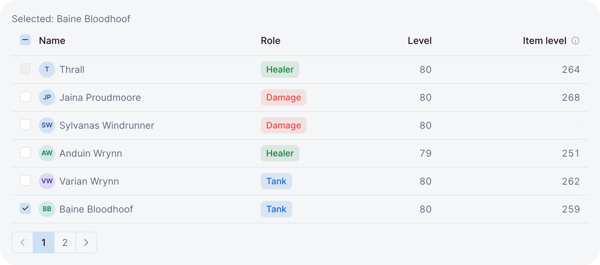
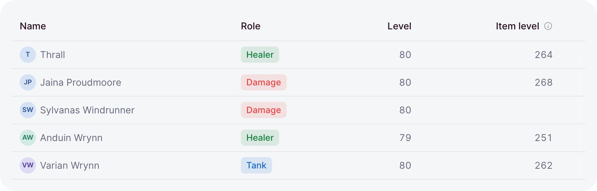

# Tables

`table` shows a list of rows as a table. You hand it a getter for the rows and describe the
columns; every feature, from sorting to row menus, turns on by the option you pass.

```ts
// dashboard/pages/raiders.ts
import { defineDashboardPage, page, table } from 'ohnejs/dashboard';

interface Raider {
  name: string;
  role: string;
  level: number;
}

const raiders: Raider[] = [
  { name: 'Thrall', role: 'Shaman', level: 80 },
  { name: 'Jaina Proudmoore', role: 'Mage', level: 80 },
  { name: 'Anduin Wrynn', role: 'Priest', level: 79 },
];

export default defineDashboardPage(() =>
  page(
    { title: 'Raiders' },
    table(() => raiders, {
      key: (raider) => raider.name,
      columns: {
        name: { label: 'Name', value: (raider) => raider.name, sortable: 'text' },
        role: { label: 'Role', value: (raider) => raider.role },
        level: { label: 'Level', value: (raider) => raider.level, align: 'end' },
      },
    }),
  ),
);
```

<picture>
  <source media="(prefers-color-scheme: dark)" srcset="../images/kit/table-value-and-render-columns-sorted-by-a-ref-a-help-tooltip-dark.png">
  
</picture>

The row type comes from the getter, so every `raider` in the columns is a `Raider` and a typo fails
the typecheck. `key` names each row, the way [`each`](./rendering.md) does.

## Values and render

A column shows its `value`, or what `render` builds:

```ts
columns: {
  gold: { label: 'Gold', value: (raider) => raider.gold, align: 'end' },
  role: { label: 'Role', render: (raider) => badge(raider.role, { variant: 'soft' }) },
}
```

- A number value prints in the dashboard language with even-width digits; `null` prints nothing.
- `value` is also the sort key, so a rendered column can keep one to stay sortable.
- `help` adds a tooltip to the header.
- Columns show in the order you write them. Number-like names such as `'2024'` jump to the front,
  as JavaScript orders such keys.

## Sorting

`sortable` adds a sort button to the header:

```ts
const sort = ref<TableSort<'name' | 'level'> | null>({ column: 'level', direction: 'desc' });

table(() => raiders.value, { key, columns, sort });
```

- The table sorts by the column's `value`: numbers as numbers, text in natural order, empty values
  last.
- A click sorts ascending, a second click descending.
- Omitted, `sort` starts unsorted and the table keeps it.
- With `serverSort: true` a click only writes `sort` and the rows show in the order they come.
  Use it when your API sorts, and send `sort.value` with the request.

## Pagination

`pageSize` splits the rows into pages, with page buttons under the table:

```ts
table(() => members.value, { key, columns, pageSize: 20 })
```

- The buttons hide when everything fits on one page.
- A refresh keeps the page you are on; a new sort goes back to page one.
- For pages your API serves, render `pagination` yourself and hand the table one page of rows.

## Loading and empty

The rows getter tells the table what to show:

```ts
const raids = useResource<Raid[]>('GET /raids');

table(raids, { key: (raid) => raid.UUID, columns, empty: 'No raids planned' })
```

- `undefined` shows skeleton rows at the final row height.
- `[]` shows the empty state, reading `empty` or a default text.
- A [`useResource`](./data.md) result adds its failures: an error with a retry, or a locked state
  for a `403`.

## Opening rows

`href` makes each row lead somewhere:

```ts
table(() => raiders.value, { key, columns, href: (raider) => `/raiders/${raider.name}` })
```

- A click opens the row, and Enter opens a focused one.
- Cmd or Ctrl and a middle click open it in a new tab.
- `onOpen` runs your own code instead, or alongside.
- On a table with `selection`, a double-click opens, so a single click stays free for checkboxes.

## Selection

<picture>
  <source media="(prefers-color-scheme: dark)" srcset="../images/kit/table-selection-the-guild-master-cannot-be-selected-shift-click-ranges-dark.png">
  
</picture>

`selection` adds a checkbox per row, bound to a set of keys:

```ts
const picked = ref<ReadonlySet<string>>(new Set());

table(() => raiders.value, {
  key: (raider) => raider.name,
  columns,
  selection: { selected: picked, selectable: (raider) => raider.rank !== 'Guild Master' },
})
```

- Shift-click selects the range from the last row you picked.
- The header box selects every selectable row on the page, or clears them.
- Keys on other pages stay selected, so a selection can span pages.
- `checkboxes` decides when the column shows, and `all` replaces the header box's state and toggle.

## Row actions

<picture>
  <source media="(prefers-color-scheme: dark)" srcset="../images/kit/table-actions-menu-per-row-dark.png">
  
</picture>

`actions` adds a menu button at the end of each row:

```ts
actions: (raider) => [
  { label: 'Promote', icon: 'arrow-up', onSelect: () => promote(raider) },
  '---',
  { label: 'Remove', icon: 'trash', destructive: true, onSelect: () => remove(raider) },
]
```

The function runs each time a menu opens, so it can read live state. The items are the ones
[`menu`](./actions.md#menu) takes.

## Layout and scrolling

The table fills its container's width and scrolls sideways when the columns need more:

```ts
card(table(() => raiders.value, { key, columns, maxHeight: '24rem' }), { flush: true })
```

- The header sticks while the table has a bounded height: `maxHeight`, or a parent with a height.
- The checkbox and first columns stick to the left, the actions to the right.
- Cells stay on one line; `wrap: true` lets a column wrap, at least `minWidth` or `16rem` wide.
- `fixed: true` keeps the set `width` of each column and truncates longer text.
- Inside a container narrower than `30rem`, the first column narrows and wraps.
